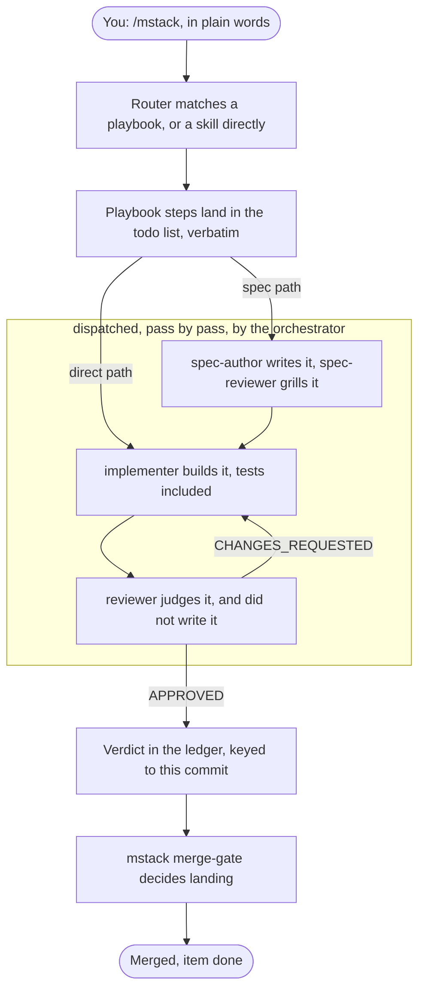

# mstack

Rigorous, verifiable agent workflows for Claude Code.

You type one command and say what you want in plain words. mstack turns it into a plan with
named steps, hands the building to an agent that cannot approve its own work, and refuses to
call anything done until a check that is code has seen the proof. Everything it knows lives in
files in your repository, so a crashed session, or you, can always see where things stand.

## One command

That is the whole interface:

```
/mstack the login form accepts an empty password
/mstack add a --json flag to the export command
/mstack why does the cache invalidate twice on startup
/mstack pick up whatever I left running yesterday
```

Whatever follows `/mstack` is the request. You do not pick a mode, a phase, or an agent. The
router reads what you wrote, matches it to a playbook, and copies that playbook's steps into
the todo list **before** it reasons about your task, so you see the plan it intends to follow
while arguing with it is still cheap.

Twelve other `/mstack:<name>` commands exist. You type one of them yourself: `/mstack:setup`,
once per repository, below. Five are steps the router calls for you as a playbook needs them,
so you never have to type `understand`, `design`, `verify`, `review` or `ship`. The last six,
`implement`, `spec`, `orchestrate`, `reflect`, `unslop` and `commit`, are there for when you
already know exactly what you want.

## Install

Nothing to build: the TypeScript in `src/` is what runs.

```
/plugin marketplace add romerma/mstack
/plugin install mstack@mstack
```

Or point Claude Code at a clone:

```bash
git clone https://github.com/romerma/mstack.git
claude --plugin-dir "$PWD/mstack"
```

Then once per repository, to create the durable store:

```
/mstack:setup
```

After that, `/mstack <what you want done>` is the only command you need. The first run
command by command, with real output, is
[docs/wiki/Getting-Started.md](docs/wiki/Getting-Started.md).

## What happens when you type it



One box is deliberately missing: the session gate, `mstack gate`, is not a step in this flow.
The `Stop` hook runs the fast gate at the end of every turn, and every pass runs `mstack gate`
before it acts, so it can go red at any point in the picture.

## The seven playbooks

A playbook is a short numbered step list. The router picks one from your request and copies its
steps into the todo list verbatim. A step it declines stays in the list as `skip: <reason>`,
because the failure mode is reading a playbook and then writing a bespoke plan that quietly
drops its named steps.

| When your request sounds like | Playbook | What it forces |
|---|---|---|
| "how does X work", "why is it like this" | **investigate** | Splits how-it-works from why-it-is. Past three moving parts, fans out narrow readers instead of one broad one, and says where each claim's evidence stopped |
| "X is broken, wrong, or slow" | **bug-fix** | Reproduce it first or stop, no repro no fix. Failing test before the fix, and the repro commit lands **before** the fix in history so the broken state stays checkoutable |
| "build X" | **feature** | Understand the subsystem before adding a parallel one. Two structurally distinct designs before picking, or a stated reason the constraints forced the answer. A throughput checkpoint that says what can actually run in parallel |
| "clean this up without changing behaviour" | **refactor** | Characterization tests committed *before* anything is touched. Migrate callers and delete the old path in the same change. Verify by re-running those tests unedited |
| "run this whole program of work" | **orchestrate** | Many changes, several tracks, more than one session, isolated worktrees |
| "pick up where we left off" | **resume** | Read the checkpoint and the reports that already ran rather than redoing them. Where the record and the repository disagree, the repository wins |
| "delete the dead branches" | **cleanup** | Lists candidates and removes nothing until you have read the list. Deletes with `git branch -d`, never `-D`, because the refusal is the safety mechanism |

The orchestrate playbook opens by telling you not to use it. In one measured head-to-head its
ceremony turned a twelve-unit job into one landed unit while a plain agent landed all twelve,
so anything one agent could finish in a session goes to **feature** instead.

Four requests skip the playbooks, because one skill is the whole answer: proving a change
works is `/mstack:verify`, judging work that already exists is `/mstack:review`, getting it
merged is `/mstack:ship`, and writing the commit message or a PR title is `/mstack:commit`.

## The five agents

The router does not do the work. It delegates, so that the pass which judges a change is never
the pass that wrote it. Each agent runs in its own context and its deliverable is a file on
disk, not a reply, because a reply is not evidence.

| Agent | What it does | What it cannot do |
|---|---|---|
| **implementer** | Implements exactly one item, writes the tests that prove it, records the requirement-to-test map | Cannot mark its own work approved or done |
| **reviewer** | Judges one implementation against its requirements, its tests and the real diff. Runs the verification itself and returns `APPROVED` or `CHANGES_REQUESTED` | Ships **without `Write` and without `Edit`** |
| **spec-author** | Writes proposal, design, tasks and requirements with stable R-ids on the spec path | Cannot review its own spec |
| **spec-reviewer** | Grills a spec adversarially before a line of code exists | No `Write`, no `Edit`, and never reviews a spec it wrote |
| **orchestrator** | Owns one item from intake to close, picks the next role, monitors every launched agent to a terminal result | No `Write`, no `Edit`: never writes application code |

For the three roles without `Write` and `Edit`, the rule is not "please do not edit the code you
are reviewing". The tool is not there. They do carry `Bash`, because a reviewer has to run the
verification itself, so this is a speed bump with an audit trail rather than a sandbox: editing
a file still takes a visible shell command a human reads in the transcript. That is the honest
strength of the claim, and it is worth having.

Who does what, in full, is [docs/wiki/The-Agents.md](docs/wiki/The-Agents.md).

## The thirteen skills

You need the first one. The router calls five of the others for you; the rest are there for
when you want them.

| | |
|---|---|
| `/mstack <request>` | **The front door.** Matches your request to a playbook and routes the work end to end |
| `/mstack:setup` | Creates `.mstack/` and seeds the queue from what the repository already tells you |
| `/mstack:understand` | How a subsystem works now, and why it ended up that way |
| `/mstack:design` | Structurally distinct candidates, judged against criteria fixed in advance, with the rejected ones recorded |
| `/mstack:spec` | Requirements with stable ids, then an adversarial review, before any code |
| `/mstack:implement` | One item, with the tests that prove it |
| `/mstack:verify` | Proves one claim on the surface where it is actually true or false, and records a typed verdict |
| `/mstack:review` | Judges existing work using reviewers that did not write it |
| `/mstack:ship` | Review threads, CI and the merge gate, to merged |
| `/mstack:orchestrate` | A program of work across many changes and sessions |
| `/mstack:reflect` | What should change in the workflow itself after a session |
| `/mstack:unslop` | Cuts the tells that make writing read as machine-generated |
| `/mstack:commit` | Holds a commit message to Conventional Commits 1.0.0, with the type the change earns |

The router answers plain `/mstack` because its front matter says `name: mstack`: Claude Code
registers a skill under `/<plugin>:<directory>` and, when the declared name carries no colon,
registers that name as a bare alias too. The route table and the playbooks are in
[docs/wiki/Skills-and-Playbooks.md](docs/wiki/Skills-and-Playbooks.md).

## Why the rules are code

Claude Code's documentation states the constraint plainly:

> Claude Code does not re-read the skill file on later turns [...] use hooks to enforce
> behavior deterministically.

Skill content enters the conversation once and stays there. So a rule written in a skill is a
rule the model may drift from, and every workflow built purely out of prose has the same
ceiling. pstack ships 44 skills, 23 playbooks and **zero hooks**; its own feature playbook says
a design pass is required and then supplies the escape hatch two lines later.

mstack splits the two. Judgment lives in skills. Anything that must hold whether or not the
model remembers it lives in a hook or in a gate that is code.

## Your first item, in five commands

The output below is from a real run. Both refusals are the product behaving as designed.
(The rule for every transcript here and in the wiki: it is produced and re-run by the mstack
repository's own `./bin/mstack` at the commit that edits it, and spelled `$ mstack` because
for you, with the plugin installed, that is the right command — the distinction matters only
inside the mstack repo itself; see [Development](#development).)

```bash
$ mstack state add --slug greet-flag --title "greet --shout uppercases the greeting" \
    --acceptance '`python3 greet.py --shout world` prints HELLO, WORLD' \
    --acceptance "test_greet.py covers the flag and the default"
added 1 greet-flag (pending)

$ mstack state set greet-flag --status in_progress
1 greet-flag (in_progress)
  status: "pending" -> "in_progress"
```

Do the work, then try to close it directly:

```bash
$ mstack state set greet-flag --status done
mstack: in_progress -> done is not a legal transition
        pass --force if you mean to skip a phase, and say why in decisions.tsv
```

The lifecycle goes through `reviewing` and `verifying`, and the close needs a ledger verdict.
The implementer's own row is not enough:

```bash
$ mstack ledger record greet-flag "$(git rev-parse HEAD)" test-verified \
    --evidence "python3 -m unittest test_greet -v: 2 tests, OK" --verifier implementer
recorded test-verified for greet-flag at 4b63888b

$ mstack gate    # after moving the item to done
[fail]  items closed on a verdict from the pass that wrote the code: greet-flag (only implementer)
        fix: a closing verdict has to come from somewhere other than the implementer; run the
        verification again from a pass that did not write it
```

A reviewer that did not write the code re-runs the verification, records its own row, and the
gate goes green. The whole walkthrough, including the product-fork refusal, is
[docs/wiki/How-A-Work-Item-Flows.md](docs/wiki/How-A-Work-Item-Flows.md).

## What you get

### A product fork is a gate, not a note

An item can carry `decision_required`: prose naming a question whose two answers produce
different work. Past `specifying` the gate refuses to let it move until the fork is answered, and answering it
means `mstack decide --resolves <slug>`: the reasoning goes to `decisions.tsv` in a row that
**names the item it answers**, and the item gets a pointer back to that row. A blank decision,
or one whose result is still `open`, is refused by the CLI and rejected by the gate.

Forks are usually found while `specifying`, which is after intake, so `mstack state set <ref>
--decision-required "<the question>"` attaches one there. Past that line the CLI refuses in both
directions: an item already building cannot have a fork bolted on, because it would be past a
gate it never passed. `--force` still does it, and prints the gate failure it just created.

```bash
$ mstack state set export-json --status spec_ready
mstack: export-json has an unanswered decision: "Is this a stable public contract other tools
        may depend on, or a convenience dump we are free to change? The two answers produce
        different work: one needs a version field and a compatibility rule, the other does not."
        answer it with 'mstack decide --resolves export-json ...' first
```

### A verification nobody ran is not a check

An item carries the exact command that proves it works. That field used to be executed by
nothing but a human typing `mstack gate --full`: in one real session it held a non-executable
string from intake — half command, half prose — and stayed red for 230 minutes across four
agent passes, because `sh -n` accepts such a string and only *running* it says otherwise.

So `--full` records what it ran, against which commit and working tree, and how it went, and the
fast gate reads that back. From `verifying` on, an item whose verification has no passing run
here is a gate failure; moving it to `done` to make the gate stop looking is refused at the
transition; and an uncommitted edit to code after the run voids the run, because a receipt that
certified only the commit would call a verification green while it was red right now. That last
part is keyed on the *contents* of what is uncommitted rather than on which files are dirty,
which is the difference between a guarantee and a sentence that sounds like one.

```bash
$ mstack state set greet-flag --status done
mstack: greet-flag cannot close on a verification that has not run: `python3 -m unittest
        test_greet` ran at e735b338 and failed
        run 'mstack gate --full' at this commit; closing is the one moment the run has to be
        real, and --force closes it unverified
```

Nothing runs a test suite on a hook. The `Stop` hook reads one small file, and the line falls at
`verifying` because that is the only legal way into `done` — held any earlier, the gate would
go red after every commit for the whole phase where most commits happen, and that is the version
of this feature people switch off.

### Two paths, one bar for proof

Most work goes straight to implementation. The spec path turns on when the item is marked
`sdd`, carries a `decision_required` field, or crosses several subsystems. The route changes how
work is planned. It never changes what counts as evidence.

```
/mstack
   ├─ small, obvious ──────────────────────────────┐
   └─ sdd | decision_required | cross-cutting      │
          └─ spec ─► grill ─► review (different pass)
                                    │              │
                                    ▼              ▼
                            implement (subagent)
                                    ▼
                        verify ─► ledger(target, sha, verdict)
                                    ▼
                        review (agent with no Write, no Edit)
                                    ▼
                            merge gate (code, not prose)
```

### Enforcement that runs whether the model cooperates or not

| Hook | What it does |
|---|---|
| `SessionStart` | Puts the active item and the last checkpoint back in context. Runs again on `--resume`, which is the case that matters |
| `PostToolUse` | The cheapest useful check. Exits 0 unconditionally: it nudges, it never blocks |
| `SubagentStop` | Confirms the subagent left its report on disk. **A reply is not evidence, the file is** |
| `Stop` | Runs the fast gate. Returns feedback rather than a block: the same loop protections apply, including the eight-continuation cap, but the transcript labels it feedback and no hook error is raised. The failures go into that feedback, and onto the hook's stderr |
| `PreToolUse` | Denies force-push, hard reset, `branch -D`, `pr merge --admin`. PreToolUse hooks run before the permission prompt, and it follows from that ordering that the deny holds even under `bypassPermissions` |

### State that survives a dead context window

```
.mstack/
├── state.json        work items and the lifecycle the gate enforces
├── ledger.tsv        target · sha · verdict · evidence · verifier · ts
├── decisions.tsv     ts · phase · decision · why · evidence · result · resolves
├── verification.tsv  target · sha · command · outcome · ts   (machine-local, gitignored)
├── progress/         current.md (live) · history.md (append-only) · <kind>_<slug>.md
└── specs/<slug>/     proposal · design · tasks · spec
```

Two files with opposite disciplines: `current.md` is overwritten every session and its last
section answers "if this dies now, what should the next session do first". `history.md` is
append-only and never edited; if an entry turned out to be wrong, a later one says so.

## The CLI

`bin/mstack` is on `PATH` whenever the plugin is enabled.

| Command | |
|---|---|
| `mstack gate` | Fast session gate, milliseconds. `--full` also runs the project's verification, and records that it did |
| `mstack state add\|set\|list\|active` | The work queue |
| `mstack ledger record\|check\|summary` | Typed verdicts keyed by `(target, sha)` |
| `mstack decide` | One row per decision, append-only |
| `mstack worktree new\|list\|prune` | Including the prune that nobody ever gets round to |
| `mstack merge-gate <pr>` | Exit 0 go, 1 wait, 2 stop |
| `mstack fanout plan\|check` | Allocates a report path per parallel worker, then names the ones that did not return |
| `mstack statusline` | One line of session state, for your `statusLine` setting |
| `mstack lint-plugin` | Validates the prose: front matter, links, size caps, single source of truth |

### What the gate actually catches

The load-bearing check is a shape check, not a parse check:

```bash
$ echo '{"items": {}}' > .mstack/state.json && mstack gate
[fail]  .../.mstack/state.json parses but has the wrong shape: .items must be an array, got an object
        fix: this is the shape that silently disables every check below it
```

`JSON.parse` accepts that file. So does `jq empty`. Every query downstream then reads
`undefined`, every comparison sees an empty string and never fires, and a gate without this
check reports green while enforcing nothing. That defect is a real one: it shipped, in
production, in the harness this was drawn from, and the gate's own comment pins it to two of
the harness's issue numbers. Every check is walked in
[docs/wiki/Gates-and-Hooks.md](docs/wiki/Gates-and-Hooks.md).

## The status line

The status line exists for one signal nothing else can deliver in time: **a verdict going
stale**. A ledger row is keyed by `(target, sha)`, and a new head SHA voids it. The gate catches
that, but only when something runs the gate, and by then the work has usually moved on. pstack's
own shipping playbook records what that costs — *"twenty-one verdicts went stale this way in
one run with no signal at all"*. A row re-read every turn is where that signal belongs.

```
Opus · fix/cli-search · #2 cli-search · in_progress · verdict stale · ctx 31%
```

Claude Code takes `statusLine` from **your** settings, not from a plugin, so wire it up
yourself, in `~/.claude/settings.json` or the project's `.claude/settings.json`:

```json
{
  "statusLine": {
    "type": "command",
    "command": "mstack statusline",
    "refreshInterval": 10
  }
}
```

The subagent panel rows, the degradation rules, the absolute-path note and the reason mstack
does not ship a `subagentStatusLine` of its own are in
[docs/wiki/Status-Line.md](docs/wiki/Status-Line.md).

## Runtime

There is **no build step and no committed artifact**. The TypeScript in `src/` is what runs, so
the file you review is the file that executes.

`bin/mstack` is a small `sh` launcher. Claude Code ships as a native binary and hands plugins no
runtime, so it resolves against whatever is already on the machine: `bun` runs `.ts` natively,
and `node` strips types from 22.6 onward.

Running source directly is normally the slow choice. It is not here, because the launcher sets
`NODE_COMPILE_CACHE`, pointed at `${CLAUDE_PLUGIN_DATA}` so it survives plugin updates. Measured
on an M-series Mac, on the post-edit hook, which is the hottest path in the plugin:

| | |
|---|---|
| bun, `src/cli.ts` | 21.7 ms |
| node, `src/cli.ts`, cold | 48.0 ms |
| node, `src/cli.ts`, cached | **23.8 ms** |
| node, pre-bundled `dist/cli.js` | 21.5 ms |

Two milliseconds is not worth a build artifact in version control. A committed bundle cannot be
reviewed, drifts from its source, and puts a diff in every commit that nobody reads. The cache
invalidates itself when the source changes, and it costs 180 KB in a directory Claude Code
already manages.

The CLI uses only `node:` builtins with zero dependencies, so both runtimes execute it
identically, and CI runs the tests under both plus the node branch of the launcher, so the
fallback cannot rot. The 22.6 floor is a measured claim, not an inherited one: the full suite
runs green on 22.6.0 and CI keeps a job pinned there. `--experimental-strip-types` is a silent
no-op on versions where stripping is already the default, so passing it always widens support
rather than narrowing it, and `--disable-warning=ExperimentalWarning` goes with it because on
22.6 the stripper writes to stderr on every invocation — which, on the post-edit hook, means on
every edit.

No lockfile is committed, deliberately: Claude Code auto-installs plugin dependencies when it
finds a `package.json` **and** a lockfile together, and there is nothing here for a user to
install.

## Development

```bash
bun install                       # types only, for the typechecker
bun run test                      # bun test AND node --test
bun run typecheck
./bin/mstack lint-plugin .
node scripts/check-doc-links.mjs README.md docs/wiki/*.md
claude --plugin-dir .             # then /reload-plugins after editing hooks or agents
claude plugin validate . --strict
```

One rule is worth stating here because it bites before CONTRIBUTING.md gets read: inside
this repository, the `mstack` on `PATH` is the *installed* plugin, not your checkout, and an
older copy reports green on checks it does not contain. Every CLI call here is
`./bin/mstack` — `./bin/mstack version` prints which copy is running. The gate does turn red
when a foreign copy runs against this repository's store, but only once the installed copy
is new enough to contain that check; a copy installed before it existed still reports green
and says nothing, which is why the habit, not the check, is what protects you today. The
command transcripts in this README and the wiki are spelled `$ mstack ...` for a reader
running the installed plugin; the binary that produces and re-runs them is the checkout's
own `./bin/mstack` at the commit that edits them.

The contribution rules that are not obvious from the code — no build step, no runtime
dependencies, both runtimes green, output pasted from real runs — are in
[CONTRIBUTING.md](CONTRIBUTING.md). The security posture, and where to report a
vulnerability privately, is in [SECURITY.md](SECURITY.md).

`examples/notes-cli/` is a working repository with a seeded queue: one closed item, one that
takes the direct path, and one carrying a real product fork so you can watch the same command
take the longer route. Its README includes the ways to break the gate on purpose.

## Documentation

The wiki lives in this repository, under [docs/wiki/](docs/wiki/), so it can be reviewed like
code and read before the GitHub wiki exists. These files are the wiki's source; the mechanical
publish route is [docs/wiki/Publishing-the-Wiki.md](docs/wiki/Publishing-the-Wiki.md).

| Page | |
|---|---|
| [Home](docs/wiki/Home.md) | What mstack is, and the map of every page |
| [Getting-Started](docs/wiki/Getting-Started.md) | Clone to first closed item, every command with its real output |
| [The-Story](docs/wiki/The-Story.md) | pstack, the harness, where they agree, and what the join fixed |
| [How-A-Work-Item-Flows](docs/wiki/How-A-Work-Item-Flows.md) | The lifecycle, the two paths, and the walkthrough of the example repo |
| [The-Agents](docs/wiki/The-Agents.md) | The five agents: who builds, who judges, and why nobody approves their own work |
| [Skills-and-Playbooks](docs/wiki/Skills-and-Playbooks.md) | The thirteen `/mstack` commands, the route table, and the seven playbooks |
| [Gates-and-Hooks](docs/wiki/Gates-and-Hooks.md) | The five hooks, every gate check, and the merge gate's rules |
| [The-CLI](docs/wiki/The-CLI.md) | Every subcommand with real output, exit codes, the verdict enum |
| [State-Files](docs/wiki/State-Files.md) | The anatomy of `.mstack/` column by column, and the evidence ladder |
| [Status-Line](docs/wiki/Status-Line.md) | Wiring, the stale-verdict signal, degradation rules |
| [Publishing-the-Wiki](docs/wiki/Publishing-the-Wiki.md) | How these files become the GitHub wiki |

## Credit

mstack is built on [pstack](https://github.com/cursor/plugins/tree/main/pstack) by
[Lauren Tan](https://github.com/poteto) (MIT, "Copyright (c) 2026 Lauren Tan"). The name keeps
her convention: `poteto` → `pstack`, so this Claude Code port is `mstack`. From pstack: the
router, the playbooks, the evidence ladder, the TSV decision log and the typed verification
ledger. From a spec-driven harness of my own that had been running in production: the lifecycle
gate, hooks that enforce, tool-list-as-permission roles, the progress-file discipline,
`decision_required` as a data field, and the fast/slow gate split. What is new here is joining
them and making the gates executable on Claude Code's primitives.

The full story of the port is in [docs/wiki/The-Story.md](docs/wiki/The-Story.md), and the
research behind it, with sources, is in
[docs/research/pstack-port.md](docs/research/pstack-port.md).

## License

MIT
